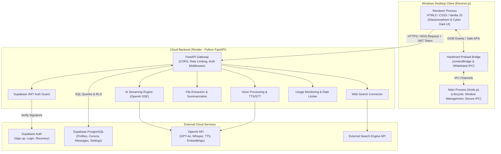

# N.A.V.I.I - System Architecture & Engineering Specifications
**Neural Assistant for Virtual Intelligence & Interaction**  
*Tagline: "Intelligence at Your Fingertips."*

---

## 1. Executive Overview
N.A.V.I.I is a professional, futuristic, cloud-powered desktop AI assistant. Designed for Windows (via Electron.js), it pairs an ultra-responsive, cyber-aesthetic desktop client with a modular, scalable cloud backend (FastAPI, Supabase, OpenAI, Render).

### Core Principles
- **Zero API Key Leakage**: No private credentials or OpenAI keys ever touch the client application. All AI calls proxy through the secure cloud backend.
- **Strict Process Isolation**: Electron uses `contextIsolation: true`, `nodeIntegration: false`, and a hardened `preload.js` bridging only explicit, validated IPC channels.
- **Subscription-Free MVP**: Current release is a pure subscription-free MVP with modular boundaries so monetization/billing tiers can be introduced cleanly in future releases without architectural rework.
- **Cloud-Powered Decoupling**: Customer desktops communicate strictly with the remote cloud backend. No developer's personal machine is ever required as a server.

---

## 2. High-Level System Architecture



---

## 3. Directory & Component Breakdown

```
NAVII/
├── .gitignore                      # Ignore credentials, node_modules, Python venvs
├── README.md                       # Master project overview & onboarding
├── desktop/                        # Electron.js Desktop Client
│   ├── package.json                # Electron dependencies, Forge scripts
│   ├── main/
│   │   ├── main.js                 # BrowserWindow initialization, security flags, lifecycle
│   │   └── ipc-handlers.js         # Window controls, native dialogs, secure storage bridge
│   ├── preload/
│   │   └── preload.js              # contextBridge exposing window.naviiAPI safely
│   ├── src/
│   │   ├── index.html              # Core single-page desktop workspace
│   │   ├── assets/
│   │   │   ├── icons/              # Futuristic vector icons & custom Navii logo
│   │   │   └── styles/
│   │   │       ├── main.css        # Cyberpunk / glassmorphism themes, variables, animations
│   │   │       ├── sidebar.css     # Collapsible navigation, chat history list
│   │   │       ├── chat.css        # Message bubbles, markdown styles, glowing neural orb
│   │   │       └── modal.css       # Settings, auth dialogs, alerts
│   │   └── js/
│   │       ├── app.js              # Root client logic, mode switching, event coordinator
│   │       ├── ui.js               # Theme toggling (Dark/Light), animations, toasts
│   │       ├── chat.js             # Real-time message streaming, markdown rendering, copy code
│   │       └── state.js            # Reactive in-memory state & preferences
│   └── forge.config.js             # Electron Forge configuration for Windows packaging
├── backend/                        # Python FastAPI Cloud Backend
│   ├── requirements.txt            # FastAPI, Uvicorn, OpenAI, Supabase, Pydantic, etc.
│   ├── .env.example                # Cloud deployment environment variables template
│   ├── app/
│   │   ├── main.py                 # FastAPI application factory, CORS, exception handlers
│   │   ├── core/
│   │   │   ├── config.py           # Pydantic BaseSettings loading validated env vars
│   │   │   └── security.py         # JWT extraction, Supabase auth verification
│   │   ├── api/
│   │   │   └── v1/
│   │   │       ├── auth.py         # Auth validation & profile endpoints
│   │   │       ├── chat.py         # Chat completions & SSE streaming
│   │   │       ├── voice.py        # Audio transcription & TTS speech synthesis
│   │   │       ├── files.py        # Document parsing (PDF, TXT, DOCX) & Q&A
│   │   │       └── search.py       # Live web search augmentation
│   │   ├── services/
│   │   │   ├── openai_service.py   # OpenAI client wrapper (streaming, prompt formatting)
│   │   │   ├── supabase_service.py # PostgreSQL database access & RLS sync
│   │   │   └── search_service.py   # Real-time search provider integration
│   │   └── models/
│   │       └── schemas.py          # Strict Pydantic models for request/response payloads
│   └── tests/
│       └── test_health.py          # Automated verification for CI/CD
└── docs/
    ├── ARCHITECTURE.md             # This architecture manual
    └── DATABASE_SCHEMA.sql         # Supabase PostgreSQL schema with RLS policies
```

---

## 4. Security & Isolation Architecture

1. **Electron Hardening**:
   - `webPreferences.contextIsolation = true` prevents renderer scripts from accessing Node.js internal contexts.
   - `webPreferences.nodeIntegration = false` disables direct file system or child process execution from renderer scripts.
   - `webPreferences.sandbox = true` activates Chromium sandbox for the renderer.
   - Secure IPC: Renderer only communicates via predefined methods on `window.naviiAPI` exposed through `contextBridge`.

2. **Backend Authentication & Authorization**:
   - All backend endpoints (except `/health` and public `/api/v1/auth/callback`) require a valid Supabase Bearer token in the `Authorization` header.
   - User identity (`user_id`) is strictly extracted from the cryptographically verified JWT payload, preventing user spoofing.
   - Supabase Row-Level Security (RLS) ensures users can query only their own conversations, messages, and settings.

3. **Desktop Automation Boundary**:
   - No arbitrary shell execution (`exec`, `spawn`, `eval`).
   - Any future desktop automation actions will follow an explicit capability-based permission model requiring clear visual confirmation dialogs.

---

## 5. Database Schema Overview (Supabase PostgreSQL)

- **`profiles`**: Stores user identity, display name, avatar, account creation timestamp.
- **`conversations`**: Stores chat sessions with titles, timestamps, and active mode (chat, coding, writing, etc.).
- **`messages`**: Stores individual conversation turns, roles (`user`, `assistant`, `system`), tokens, search citations, and attachments.
- **`user_settings`**: Stores user preferences (theme, preferred AI model, voice selection, speech speed).
- **`usage_records`**: Tracks token and request counts per user for rate limiting and AI cost control.

---

## 6. Phased Roadmap Alignment

| Phase | Title | Focus |
|---|---|---|
| **Phase 1** | **Structure, Architecture & Prototype UI** | Repository layout, package configs, futuristic UI prototype |
| **Phase 2** | **Desktop UI Refinement** | Polish glassmorphism, responsive states, transitions, accessibility |
| **Phase 3** | **Electron Desktop Functionality** | Window controls, native IPC, secure bridge, local preferences |
| **Phase 4** | **FastAPI Backend** | Cloud API server, CORS, rate-limiting, error schemas |
| **Phase 5** | **OpenAI API Integration** | Streaming completions (SSE), prompt engineering, cost guardrails |
| **Phase 6** | **Supabase Auth & Database** | User signup/login, token validation, RLS PostgreSQL sync |
| **Phase 7** | **Chat History & User Settings** | Conversation CRUD, real-time sync, persistent preferences |
| **Phase 8** | **Voice, Writing, Code & File Assistants**| Whisper STT, TTS, document text parsing, multi-language coding |
| **Phase 9** | **Web Search Integration** | Live web search API connector, citation rendering |
| **Phase 10**| **End-to-End Testing & Hardening** | Unit & integration tests, error recovery, security audit |
| **Phase 11**| **Render Cloud Deployment** | Cloud backend live deployment, CORS lockdown, production health |
| **Phase 12**| **Windows Installer (Electron Forge)** | Distribution-ready Windows installer (.exe/squirrel/NSIS) |
| **Phase 13**| **Documentation & Production Release** | User manual, developer docs, final production signoff |
