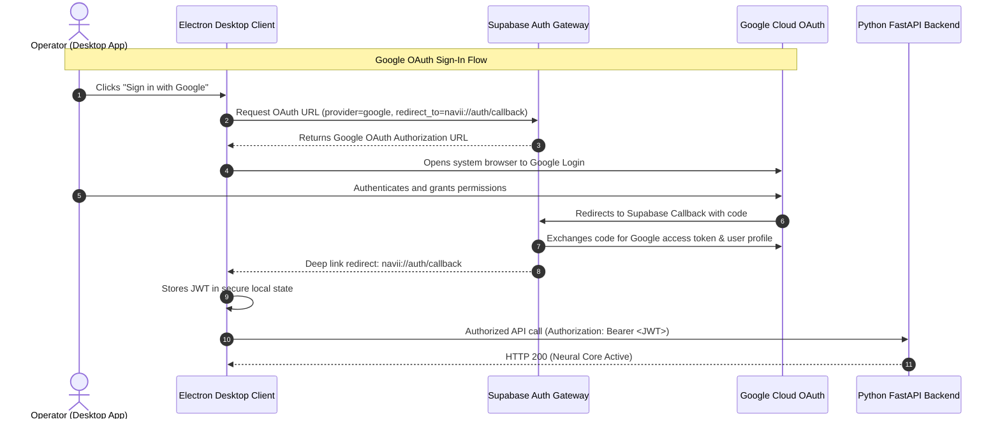

# Google Cloud Console & Supabase Auth Setup Guide for N.A.V.I.I

This guide details the exact steps required to configure **Google OAuth 2.0 (Sign in with Google)** and **Email & Password authentication** for the **N.A.V.I.I Desktop Application** using **Supabase Auth**.

---

## Architecture Overview



---

## Step 1: Create a Google Cloud Project

1. Navigate to the **[Google Cloud Console](https://console.cloud.google.com/)**.
2. Sign in with your Google / Gmail account.
3. At the top left (next to the "Google Cloud" logo), click the **Project Dropdown** and select **New Project**.
4. Configure your project:
   - **Project Name**: `NAVII-AI-Assistant` (or your preferred name)
   - **Organization**: Leave as *No organization* (or select your organization if applicable)
5. Click **Create** and wait a few seconds for the project to provision.
6. Select the newly created project from the top dropdown or the notification bell.

---

## Step 2: Configure the OAuth Consent Screen

1. In the left navigation menu, go to **APIs & Services** > **OAuth consent screen** (or search "OAuth consent screen" in the search bar).
2. Choose **User Type**:
   - Select **External** (allows any Google account to sign in).
   - Click **Create**.
3. Fill in **App Information**:
   - **App name**: `N.A.V.I.I`
   - **User support email**: Select your Gmail address.
   - **App logo**: Optional (can upload `desktop/src/assets/icons/navii-logo.png`).
4. Fill in **App Domain** (Optional for testing, required for public verification later):
   - **Application home page**: `https://navii.ai` (or your landing page)
   - **Privacy Policy**: `https://navii.ai/privacy`
   - **Terms of Service**: `https://navii.ai/terms`
5. Fill in **Developer Contact Information**:
   - **Email addresses**: Your email address.
6. Click **Save and Continue**.
7. **Scopes**:
   - Click **Add or Remove Scopes**.
   - Select the 3 standard basic scopes:
     - `.../auth/userinfo.email` (See your primary Google Account email address)
     - `.../auth/userinfo.profile` (See your personal info, including profile info and photo)
     - `openid` (Associate you with your personal info on Google)
   - Click **Update** at the bottom of the drawer, then click **Save and Continue**.
8. **Test Users** (Since the app starts in *Testing* mode):
   - Click **Add Users**.
   - Add your own Gmail address (and any other emails you want to test with).
   - Click **Save and Continue**.
9. Review the summary and click **Back to Dashboard**.

---

## Step 3: Create OAuth 2.0 Credentials in Google Cloud

> [!IMPORTANT]
> **Why choose "Web application" instead of "Desktop app"?**  
> Because Supabase Auth acts as the secure server-side broker that completes the OAuth token exchange and mints your application's JWT session, Google must redirect the authorization code back to Supabase's secure callback URL. Therefore, the Google Client must be created as a **Web application**.

1. In the left sidebar, navigate to **APIs & Services** > **Credentials**.
2. Click **+ Create Credentials** at the top and select **OAuth client ID**.
3. In the **Application type** dropdown, select **Web application**.
4. Set the **Name**: `NAVII Supabase Auth Client`.
5. Under **Authorized JavaScript origins**:
   - Click **+ Add URI**
   - Add: `https://<YOUR-SUPABASE-PROJECT-REF>.supabase.co`
   - Add (for local development): `http://localhost:8000` and `http://127.0.0.1:8000`
6. Under **Authorized redirect URIs**:
   - Click **+ Add URI**
   - Enter your Supabase project callback URL:
     ```
     https://<YOUR-SUPABASE-PROJECT-REF>.supabase.co/auth/v1/callback
     ```
     *(You will find your exact Project Ref in your Supabase Dashboard under Project Settings > API).*
7. Click **Create**.
8. A modal will appear displaying:
   - **Client ID** (e.g., `1234567890-abcdef.apps.googleusercontent.com`)
   - **Client Secret** (e.g., `GOCSPX-xxxxxxxxxxxxxxxxxxxx`)
9. **Copy both values** — you will paste them into Supabase in Step 4.

---

## Step 4: Configure Google Auth in Supabase

1. Open your **[Supabase Dashboard](https://supabase.com/dashboard)**.
2. Select your N.A.V.I.I project.
3. In the left sidebar, navigate to **Authentication** > **Providers**.
4. Find **Google** in the list of providers and click to expand it.
5. Toggle **Enable Google provider** to `ON`.
6. Paste your credentials obtained in Step 3:
   - **Client ID**: Paste your Google Client ID.
   - **Client Secret**: Paste your Google Client Secret.
7. Click **Save**.

---

## Step 5: Enable Email & Password Login in Supabase

1. In Supabase Dashboard, go to **Authentication** > **Providers**.
2. Click **Email**.
3. Ensure **Enable Email provider** is toggled `ON`.
4. (Recommended for local desktop development):
   - Toggle **Confirm email** to `OFF` if you want instant login without waiting for email verification links during testing. (For production, keep it `ON`).
5. Click **Save**.

---

## Step 6: Configure Desktop App Redirect URLs in Supabase

For the Electron desktop app to receive the OAuth token from Google and Supabase:

1. In Supabase Dashboard, go to **Authentication** > **URL Configuration**.
2. Under **Site URL**, set:
   ```
   navii://auth/callback
   ```
   *(Or for local web testing: `http://localhost:8000`)*
3. Under **Redirect URLs**, click **Add URL** and add the following:
   - `navii://auth/callback` (Custom protocol handled by Electron)
   - `http://localhost:8000/**`
   - `http://127.0.0.1:8000/**`
4. Click **Save**.

---

## Summary of Credentials to Save in N.A.V.I.I

Store these in your `backend/.env` file:

```env
# Supabase Cloud Project Configuration
SUPABASE_URL=https://<YOUR-SUPABASE-PROJECT-REF>.supabase.co
SUPABASE_KEY=<YOUR-SUPABASE-ANON-PUBLIC-KEY>
SUPABASE_SERVICE_ROLE_KEY=<YOUR-SUPABASE-SERVICE-ROLE-SECRET-KEY>
SUPABASE_JWT_SECRET=<YOUR-SUPABASE-JWT-SECRET>

# Google OAuth Client (for reference)
GOOGLE_CLIENT_ID=<YOUR-GOOGLE-CLIENT-ID>.apps.googleusercontent.com
GOOGLE_CLIENT_SECRET=<YOUR-GOOGLE-CLIENT-SECRET>
```
